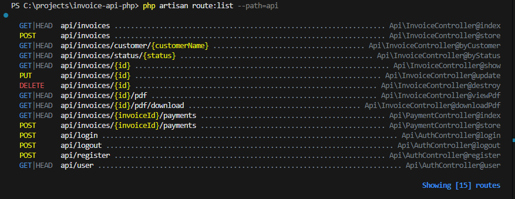
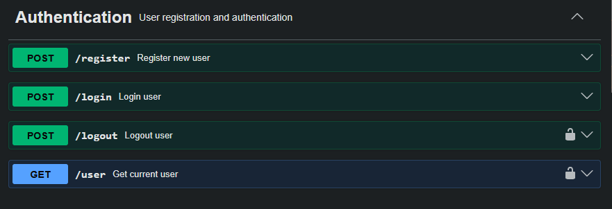
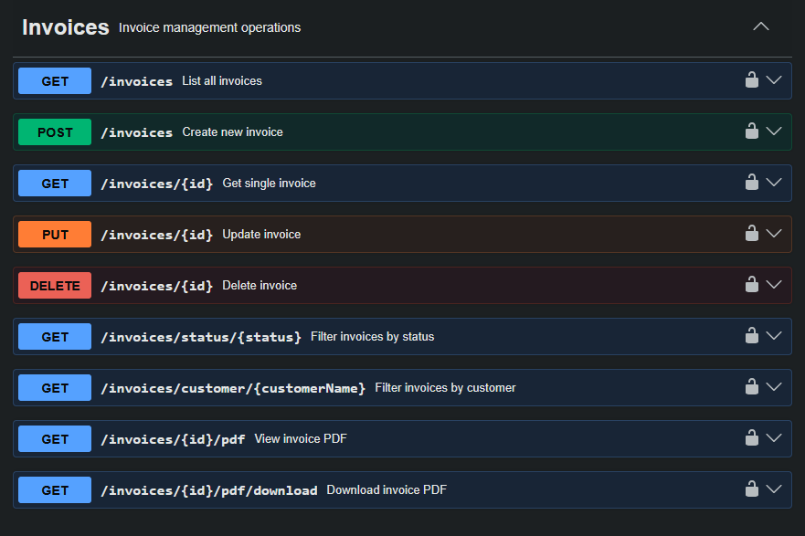
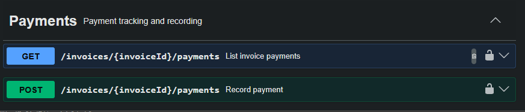
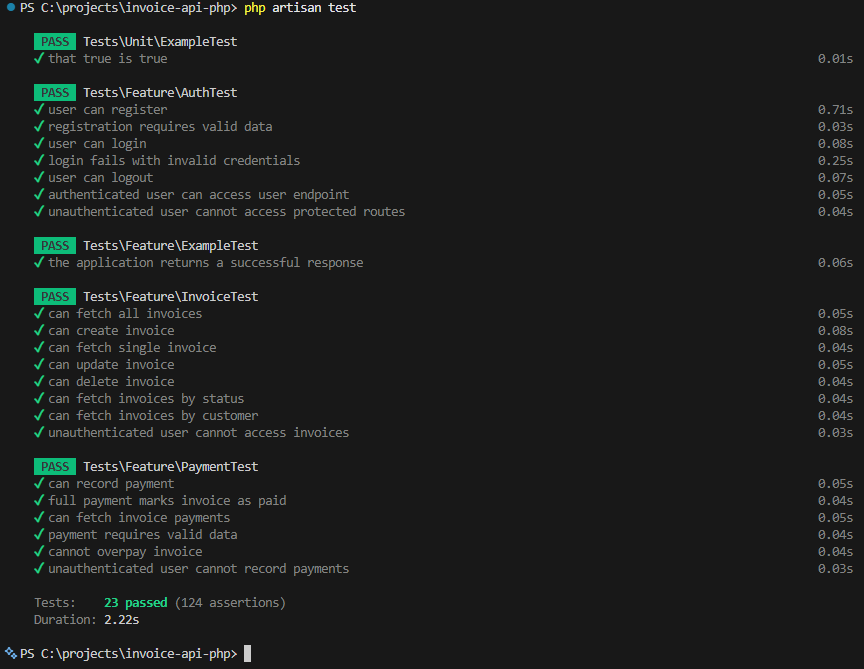

# Invoice API Documentation



## Base URL
```
http://localhost:8000/api
```

## Authentication

This API uses Laravel Sanctum for authentication. Include the token in the Authorization header:
```
Authorization: Bearer {your_token_here}
```

---

## Authentication Endpoints



### Register

**POST** `/register`

Create a new user account.

**Request Body:**
```json
{
  "name": "John Doe",
  "email": "john@example.com",
  "password": "password123",
  "password_confirmation": "password123"
}
```

**Response (201):**
```json
{
  "success": true,
  "message": "User registered successfully",
  "data": {
    "user": {
      "id": 1,
      "name": "John Doe",
      "email": "john@example.com",
      "created_at": "2025-01-15T10:00:00.000000Z",
      "updated_at": "2025-01-15T10:00:00.000000Z"
    },
    "access_token": "1|abc123...",
    "token_type": "Bearer"
  }
}
```

---

### Login

**POST** `/login`

Authenticate and receive an access token.

**Request Body:**
```json
{
  "email": "john@example.com",
  "password": "password123"
}
```

**Response (200):**
```json
{
  "success": true,
  "message": "Login successful",
  "data": {
    "user": {
      "id": 1,
      "name": "John Doe",
      "email": "john@example.com"
    },
    "access_token": "2|xyz789...",
    "token_type": "Bearer"
  }
}
```

**Error Response (401):**
```json
{
  "success": false,
  "message": "Invalid login credentials"
}
```

---

### Logout

**POST** `/logout`

Revoke the current access token.

**Headers:**
```
Authorization: Bearer {token}
```

**Response (200):**
```json
{
  "success": true,
  "message": "Logged out successfully"
}
```

---

### Get Current User

**GET** `/user`

Get the authenticated user's information.

**Headers:**
```
Authorization: Bearer {token}
```

**Response (200):**
```json
{
  "success": true,
  "data": {
    "user": {
      "id": 1,
      "name": "John Doe",
      "email": "john@example.com"
    }
  }
}
```

---

## Invoice Endpoints



All invoice endpoints require authentication.

### List All Invoices

**GET** `/invoices`

**Headers:**
```
Authorization: Bearer {token}
```

**Response (200):**
```json
{
  "success": true,
  "data": [
    {
      "id": 1,
      "invoice_number": "INV-2025-001",
      "issue_date": "2025-01-15",
      "due_date": "2025-02-15",
      "customer_name": "Acme Corporation",
      "customer_email": "billing@acme.com",
      "customer_address": "123 Business St, City, State 12345",
      "sub_total": 1000.00,
      "tax_amount": 100.00,
      "discount_amount": 0.00,
      "total_amount": 1100.00,
      "amount_paid": 500.00,
      "balance_due": 600.00,
      "status": "Partially Paid",
      "notes": "Net 30 payment terms",
      "created_at": "2025-01-15T10:00:00.000000Z",
      "updated_at": "2025-01-20T14:30:00.000000Z",
      "items": [
        {
          "id": 1,
          "description": "Web Development Services",
          "quantity": 10,
          "unit_price": 100.00,
          "tax_rate": 0.00,
          "line_total": 1000.00
        }
      ]
    }
  ]
}
```

---

### Create Invoice

**POST** `/invoices`

**Headers:**
```
Authorization: Bearer {token}
```

**Request Body:**
```json
{
  "invoice_number": "INV-2025-002",
  "issue_date": "2025-01-15",
  "due_date": "2025-02-15",
  "customer_name": "Tech Solutions Inc",
  "customer_email": "accounts@techsolutions.com",
  "customer_address": "456 Tech Park, City, State 67890",
  "tax_amount": 50.00,
  "discount_amount": 10.00,
  "status": "Draft",
  "notes": "Payment due upon receipt",
  "items": [
    {
      "description": "Consulting Services",
      "quantity": 5,
      "unit_price": 150.00,
      "tax_rate": 0.00
    },
    {
      "description": "Software License",
      "quantity": 1,
      "unit_price": 500.00,
      "tax_rate": 10.00
    }
  ]
}
```

**Response (201):**
```json
{
  "success": true,
  "message": "Invoice created successfully",
  "data": {
    "id": 2,
    "invoice_number": "INV-2025-002",
    "issue_date": "2025-01-15",
    "due_date": "2025-02-15",
    "customer_name": "Tech Solutions Inc",
    "customer_email": "accounts@techsolutions.com",
    "total_amount": 1290.00,
    "balance_due": 1290.00,
    "status": "Draft",
    "items": [...]
  }
}
```

**Note:** If `customer_email` is provided, an email notification will be sent automatically.

---

### Get Single Invoice

**GET** `/invoices/{id}`

**Headers:**
```
Authorization: Bearer {token}
```

**Response (200):**
```json
{
  "success": true,
  "data": {
    "id": 1,
    "invoice_number": "INV-2025-001",
    "customer_name": "Acme Corporation",
    "total_amount": 1100.00,
    "items": [...]
  }
}
```

**Error Response (404):**
```json
{
  "success": false,
  "message": "Invoice with ID 999 not found."
}
```

---

### Update Invoice

**PUT** `/invoices/{id}`

**Headers:**
```
Authorization: Bearer {token}
```

**Request Body** (all fields optional):
```json
{
  "customer_name": "Updated Company Name",
  "status": "Sent",
  "notes": "Updated payment terms",
  "items": []
}
```

**Response (200):**
```json
{
  "success": true,
  "message": "Invoice updated successfully",
  "data": {
    "id": 1,
    "customer_name": "Updated Company Name",
    "status": "Sent",
    ...
  }
}
```

---

### Delete Invoice

**DELETE** `/invoices/{id}`

**Headers:**
```
Authorization: Bearer {token}
```

**Response (200):**
```json
{
  "success": true,
  "message": "Invoice deleted successfully"
}
```

---

### Filter Invoices by Status

**GET** `/invoices/status/{status}`

**Headers:**
```
Authorization: Bearer {token}
```

**Parameters:**
- `status`: Draft, Sent, Paid, Partially Paid, Overdue

**Example:**
```
GET /invoices/status/Paid
```

**Response (200):**
```json
{
  "success": true,
  "data": [
    {
      "id": 3,
      "status": "Paid",
      ...
    }
  ]
}
```

---

### Filter Invoices by Customer

**GET** `/invoices/customer/{customerName}`

**Headers:**
```
Authorization: Bearer {token}
```

**Example:**
```
GET /invoices/customer/Acme Corporation
```

**Response (200):**
```json
{
  "success": true,
  "data": [
    {
      "id": 1,
      "customer_name": "Acme Corporation",
      ...
    }
  ]
}
```

---

### View Invoice PDF

**GET** `/invoices/{id}/pdf`

**Headers:**
```
Authorization: Bearer {token}
```

**Response:** PDF file displayed in browser

---

### Download Invoice PDF

**GET** `/invoices/{id}/pdf/download`

**Headers:**
```
Authorization: Bearer {token}
```

**Response:** PDF file download

**Filename Format:** `invoice-{invoice_number}.pdf`

---

## Payment Endpoints



All payment endpoints require authentication.

### Record Payment

**POST** `/invoices/{invoiceId}/payments`

Record a payment against an invoice.

**Headers:**
```
Authorization: Bearer {token}
```

**Request Body:**
```json
{
  "amount": 500.00,
  "payment_date": "2025-01-20",
  "payment_method": "Bank Transfer",
  "reference_number": "TXN-123456",
  "notes": "Payment for January services"
}
```

**Response (201):**
```json
{
  "success": true,
  "message": "Payment recorded successfully",
  "data": {
    "payment": {
      "id": 1,
      "invoice_id": 1,
      "amount": 500.00,
      "payment_date": "2025-01-20",
      "payment_method": "Bank Transfer",
      "reference_number": "TXN-123456",
      "notes": "Payment for January services",
      "created_at": "2025-01-20T15:00:00.000000Z"
    },
    "invoice": {
      "id": 1,
      "total_amount": 1100.00,
      "amount_paid": 500.00,
      "balance_due": 600.00,
      "status": "Partially Paid"
    }
  }
}
```

**Error Response (422) - Overpayment:**
```json
{
  "success": false,
  "message": "Payment amount exceeds the remaining balance of $600.00"
}
```

**Automatic Status Updates:**
- Payment creates a record in the `payments` table
- Invoice `amount_paid` is updated
- Invoice `balance_due` is recalculated
- Invoice `status` changes to:
  - `"Partially Paid"` if balance > 0
  - `"Paid"` if balance = 0
- If fully paid, `paid_date` is set

---

### List Invoice Payments

**GET** `/invoices/{invoiceId}/payments`

Get all payments for a specific invoice.

**Headers:**
```
Authorization: Bearer {token}
```

**Response (200):**
```json
{
  "success": true,
  "data": [
    {
      "id": 1,
      "amount": 500.00,
      "payment_date": "2025-01-20",
      "payment_method": "Bank Transfer",
      "reference_number": "TXN-123456",
      "notes": "Payment for January services"
    },
    {
      "id": 2,
      "amount": 300.00,
      "payment_date": "2025-01-25",
      "payment_method": "Credit Card",
      "reference_number": "TXN-789012",
      "notes": "Second installment"
    }
  ]
}
```

---

## Error Responses

### Validation Error (422)
```json
{
  "success": false,
  "message": "Validation failed",
  "errors": {
    "email": [
      "The email field is required."
    ],
    "password": [
      "The password field must be at least 8 characters."
    ]
  }
}
```

### Unauthorized (401)
```json
{
  "message": "Unauthenticated."
}
```

### Not Found (404)
```json
{
  "success": false,
  "message": "Invoice with ID 999 not found."
}
```

### Server Error (500)
```json
{
  "success": false,
  "message": "An error occurred while processing your request.",
  "error": "Detailed error message"
}
```

---

## Field Descriptions

### Invoice Fields

| Field | Type | Required | Description |
|-------|------|----------|-------------|
| invoice_number | string(50) | Yes | Unique invoice identifier |
| issue_date | date | Yes | Date invoice was issued |
| due_date | date | Yes | Payment due date |
| customer_name | string(200) | Yes | Customer or company name |
| customer_email | string(100) | No | Customer email (triggers notification) |
| customer_address | string(500) | No | Customer billing address |
| sub_total | decimal | Auto | Calculated from items |
| tax_amount | decimal | No | Additional tax amount |
| discount_amount | decimal | No | Discount applied |
| total_amount | decimal | Auto | sub_total + tax - discount |
| amount_paid | decimal | Auto | Total payments received |
| balance_due | decimal | Auto | Remaining amount |
| status | string | No | Draft, Sent, Paid, Partially Paid, Overdue |
| notes | text | No | Additional notes or terms |

### Invoice Item Fields

| Field | Type | Required | Description |
|-------|------|----------|-------------|
| description | string(200) | Yes | Service or product description |
| quantity | decimal | Yes | Quantity of items |
| unit_price | decimal | Yes | Price per unit |
| tax_rate | decimal | No | Tax rate percentage (e.g., 10 for 10%) |
| line_total | decimal | Auto | quantity × unit_price × (1 + tax_rate/100) |

### Payment Fields

| Field | Type | Required | Description |
|-------|------|----------|-------------|
| amount | decimal | Yes | Payment amount (min: 0.01) |
| payment_date | date | Yes | Date payment was received |
| payment_method | string(50) | Yes | Method (e.g., Bank Transfer, Credit Card, Cash, Check) |
| reference_number | string(100) | No | Transaction or check number |
| notes | text | No | Additional payment notes |

---

## Example Workflow

### 1. Register & Login
```bash
# Register
curl -X POST http://localhost:8000/api/register \
  -H "Content-Type: application/json" \
  -d '{
    "name": "John Doe",
    "email": "john@example.com",
    "password": "password123",
    "password_confirmation": "password123"
  }'

# Save the token from response
TOKEN="your_token_here"
```

### 2. Create an Invoice
```bash
curl -X POST http://localhost:8000/api/invoices \
  -H "Authorization: Bearer $TOKEN" \
  -H "Content-Type: application/json" \
  -d '{
    "invoice_number": "INV-001",
    "issue_date": "2025-01-15",
    "due_date": "2025-02-15",
    "customer_name": "Acme Corp",
    "customer_email": "billing@acme.com",
    "items": [{
      "description": "Web Development",
      "quantity": 10,
      "unit_price": 100
    }]
  }'
```

### 3. Record a Payment
```bash
curl -X POST http://localhost:8000/api/invoices/1/payments \
  -H "Authorization: Bearer $TOKEN" \
  -H "Content-Type: application/json" \
  -d '{
    "amount": 500,
    "payment_date": "2025-01-20",
    "payment_method": "Bank Transfer",
    "reference_number": "TXN-123"
  }'
```

### 4. Download PDF
```bash
curl -X GET http://localhost:8000/api/invoices/1/pdf/download \
  -H "Authorization: Bearer $TOKEN" \
  --output invoice.pdf
```

---

## Testing

Run the test suite:
```bash
php artisan test
```



Test coverage includes:
- ✓ Authentication (register, login, logout)
- ✓ Invoice CRUD operations
- ✓ Invoice filtering by status and customer
- ✓ Payment recording and tracking
- ✓ Overpayment prevention
- ✓ Authorization checks
- ✓ Validation rules

---

## Rate Limiting

API requests are rate-limited to prevent abuse. Default limits apply per minute per user.

---

## Support & Community

### Connect with Me
Follow me on Twitter/X for updates and discussions: **[@1cbyc](https://x.com/1cbyc)**

### Report Issues
Found a bug or have a feature request?  
**[Create an Issue on GitHub](https://github.com/1cbyc/invoice-api-php/issues/new)**

### Documentation
For more information, refer to the [project README](README.md).

---

## License & Credits

I built this shii with Laravel  
API Documentation | Version 2.0.0


